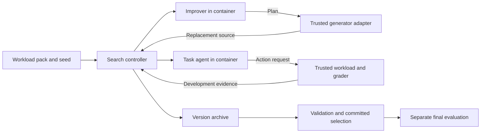

# Architecture

RSI Engine keeps the changing program separate from the machinery that measures it.

## Editable program

A candidate is exactly two UTF-8 Python modules: `task` and `improver`. There are
no filesystem patches, editable grader paths, or candidate-controlled executable
arguments. The engine syntax-checks modules on the host without importing or
executing them. A content hash identifies the pair.

Task modules expose `decide(context)` and return one action at a time. The trusted
adapter turns that request into an actual simulated effect and returns an
observation. The candidate cannot claim effects into existence or supply its own
grade. Each case starts a fresh container, so module globals do not carry across
cases.

Improver modules expose `plan(context)`. They receive development results,
execution traces, an iteration index and the public tool contract. They can ask
the generator to replace either module. An edited improver is executed before it
is admitted for further exploration.

## Fixed control

The current search rule retains a child as an active parent only when its
development correctness does not regress and it has no critical failures or
candidate execution errors. Rejected candidates remain in the archive and are
included in validation if their modules are valid. Validation selects the highest
correctness among eligible candidates, then fewer tool calls, then earliest
revision. Validation feedback is never returned to the generator.

This fixed controller is deliberately small. It does not establish whether
evolving the improvement procedure is efficient. That is a separate experiment.

## Container execution

The runner resolves the operator-selected local image to an immutable image ID.
Each candidate process uses:

- No network and no host filesystem mounts.
- Read-only root filesystem and a bounded temporary filesystem.
- UID/GID 65534, dropped capabilities, and no new privileges.
- PID, CPU, memory, file size, open-file and response-size limits.
- Python isolated mode with no site initialization.
- Bounded input writes and output reads.
- Unique container names and explicit cleanup after completion or timeout.

The image, Docker daemon and operating system remain trusted. Candidate stdout
is data, never evidence of tool effects. A candidate can fabricate an action or
planner response, but its requested actions are graded by the external adapter.
The engine does not treat the Python worker wrapper as a security boundary.

Candidate output is capped across stdout and stderr. Wall-clock deadlines bound
work; container cleanup can add a bounded delay after a deadline.

## Data and evidence

Workload files have recorded hashes. Development is used during generation;
validation is parsed after generation; final tests are parsed for evaluation only
after a committed selection is verified. Hashing a test file to record its identity
does not make its contents secret. Public demo splits reuse authored fault
templates and parameter variants.

Archives store source revisions, raw structured generator responses, requests,
per-case traces, outcome reports and parent decisions. JSON syntax failures and
subprocess failures produce failure events; unparseable generator bytes are not
retained. Provider stderr is bounded and discarded so it cannot accidentally
enter exported evidence.

Artifact digests and chained events detect edits and broken references. An actor
who can rewrite the whole archive can also recompute hashes. Signing and external
attestation are future integrations.

The evidence may contain the workload's source and observations. Runs and local
configuration are ignored by Git and created with private permissions. Review
exports before moving private evidence outside its authorized environment.
