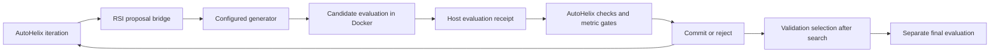

# Embedded AutoHelix

RSI Engine 0.3 embeds AutoHelix 0.1.0 as an optional iteration backend.
AutoHelix manages worktrees, history, metric gates, and accepted commits.
RSI Engine supplies the proposal generator, isolated evaluation, independent
validation selection, final evaluation, spending controls and evidence archive.

## Try it without model calls

Requirements: Python 3.12+, uv, Git, Docker and a local `python:3.12-slim` image.
Use fresh pack and output directories.

```sh
uv sync --locked --extra autohelix
uv run --locked rsi-engine init local/helix-ai-jobs --domain ai_job
uv run --locked rsi-engine demo \
  --backend autohelix --pack local/helix-ai-jobs --out runs/helix-demo
uv run --locked rsi-engine evaluate \
  --pack local/helix-ai-jobs --run runs/helix-demo --out runs/helix-demo-final
uv run --locked rsi-engine audit runs/helix-demo
uv run --locked rsi-engine export \
  runs/helix-demo --out runs/helix-demo-evidence.json
```

This demonstration uses scripted proposals. It verifies integration, including
execution of an edited improver and rejection of a regressing task revision.
It does not demonstrate learned improvement or a recursive advantage.

## Use the existing Bedrock generator

Both extras can be installed together:

```sh
uv sync --locked --extra autohelix --extra bedrock
uv run --locked rsi-engine init local/helix-composed --domain composed
uv run --locked rsi-engine run \
  --backend autohelix \
  --pack local/helix-composed \
  --bedrock-config examples/bedrock-sonnet-pilot.json \
  --policy evolving_history \
  --iterations 4 --max-case-evaluations 110 \
  --max-wall-seconds 1200 --max-steps 24 \
  --out runs/helix-model
```

The `run` command makes paid model calls. The existing Bedrock adapter controls
request size, output tokens, call count and estimated spending. Its reservation
ledger and unknown-cost handling are unchanged. Recheck the example's dated
token rates before a new paid run.

The trusted command-generator bridge is also supported through
`--generator-config`. As before, a command generator must supply its own
provider limits. Unknown usage remains unknown in RSI evidence.

## Registered comparisons

Choose the backend when registering the study:

```sh
uv run --locked rsi-engine study-prepare \
  --backend autohelix \
  --pack local/helix-composed --study runs/helix-study \
  --bedrock-config examples/bedrock-sonnet-pilot.json
uv run --locked rsi-engine study-run \
  --pack local/helix-composed --study runs/helix-study
uv run --locked rsi-engine study-evaluate \
  --pack local/helix-composed --study runs/helix-study
```

The registered protocol includes the AutoHelix version and installed package
digest. Both comparison arms use the same backend. Each embedded iteration
makes at most one RSI generator call, unlike a general coding-agent CLI that
may make many model requests per iteration.

The original live pilot used the native backend. Its recorded result is not an
AutoHelix result. Previously inspected final cases remain exposed material.

## Execution flow



AutoHelix's actual `Harness.run_iteration()` owns worktree creation, constraint
execution, metrics, history, cleanup and merging. RSI calls it once per registered
proposal allowance. This preserves fail-closed budget handling when upstream
iteration code catches exceptions.

The embedded `AgentBackend` calls our configured generator and evaluator. It
accepts only a complete replacement for the task or improver module. Source is
validated as data and executed through the Docker runner.

The evaluator writes a receipt outside the candidate worktree. AutoHelix runs
a small trusted check command that verifies the current source hashes against
that receipt. The check uses isolated Python, an empty environment and the
standard library. It never imports the candidate modules.

The receipt enforces the existing eligibility checks. AutoHelix's metric gate
rejects development-correctness regressions. Before the next iteration, RSI
verifies that the accepted workspace and the upstream decision agree.
Unexpected disagreement aborts the run.

## History, selection and evidence

AutoHelix history and the latest hypothesis note are supplied as data to the
improver and generator. Notes survive rejected proposals. No validation or
final-test feedback is included. An edited improver must still execute in
Docker and honor any registered edit schedule.

All valid candidates, including rejected search parents, remain available for
the original independent validation selection rule. An AutoHelix commit chooses
the next search parent; it does not by itself select the final candidate.

An output directory contains:

```text
artifacts/                       RSI content-addressed evidence
events.jsonl                     RSI event chain
selection.json                   Committed validation selection
autohelix/workspace/              Private scratch Git repository
autohelix/workspace/.autohelix/   Upstream history, notes and logs
autohelix/control/                Host evaluation receipts
```

The RSI export includes the backend identity, effective configuration, evaluation
receipts, upstream iteration outcomes, selected source and provider evidence.
RSI's Decimal-valued budget records remain authoritative. AutoHelix's diagnostic
cost fields use floats and omit unavailable costs; they do not enforce spending
for this integration.

## Scope and compatibility

- The dependency is pinned to the reviewed release through `uv.lock`.
- The native backend remains available with `--backend native` for comparisons.
- Stock AutoHelix coding-agent CLIs are not enabled by this integration. The
  configured upstream mock object is replaced by the RSI proposal bridge before
  execution; no mock edits or mock usage are used by the bridge.
- Run the generated configuration through `rsi-engine`. Invoking standalone
  `autohelix run` in the scratch workspace does not reproduce this integration.
- The helper and runner currently target Linux/macOS. Docker's existing trust
  and containment limitations still apply.
- Original RSI Engine code remains MIT-0. AutoHelix is a separately distributed
  Apache-2.0 dependency.
